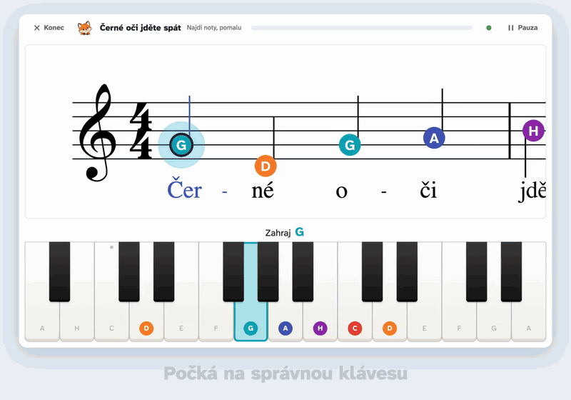
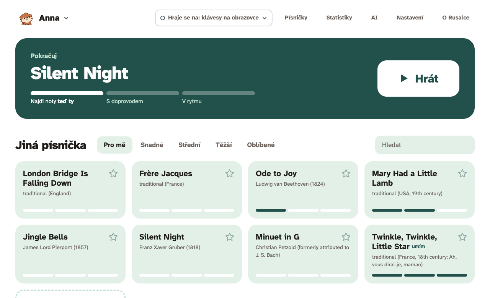
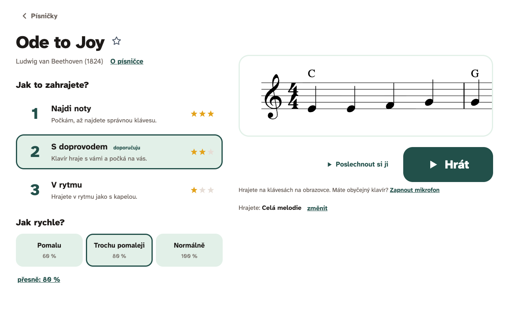
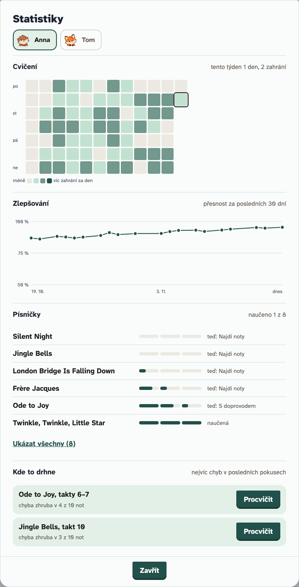

# Rusalka

English: [README.md](README.md)

Rusalka je open source klavírní aplikace zdarma pro děti a začátečníky. Vyberete písničku, zahrajete ji na klavír
připojený přes MIDI, na obyčejný klavír s mikrofonem, nebo na klávesy na obrazovce, a naučíte se ji ve třech
krocích. Běží v prohlížeči, bez účtů; písničky, hráči a výsledky zůstávají ve vašem zařízení.

**[Spustit Rusalku](https://rusalkapiano.com/)** (pro klavír přes MIDI v Chromu nebo Edge)



## Proč Rusalka vznikla
Rusalku vytvořil táta dvou báječných dětí, které si chtěly zahrát na klavír své oblíbené písničky. Not jsme k nim
doma i na internetu našli dost, jenže děti je zatím spolehlivě nepřečtou. Rusalka je tedy výsledek našeho
společného úsilí (nikdo není lepší a upřímnější QA tester než malé děti) najít zábavný způsob, jak dětem
a začátečníkům umožnit vybrané písničky zahrát a naučit se je.

Hezky se nám to časově potkalo s kvalitou současných jazykových modelů AI. Ty dovedou převést PDF i obyčejné fotky
not do formátu, kterému Rusalka rozumí. K Rusalce proto patří i doplňky do AI nástrojů: převedou noty, upraví je do
jednodušší podoby, nebo rodičům vyhodnotí, jak se dětem v posledním týdnu hudebně dařilo. Stačí k tomu obyčejný chat
s AI, Rusalka sama vaše data nikam neodesílá.

Když AI nepoužíváte, nevadí. V Rusalce najdete písničky připravené k hraní, od dětských a lidových přes vánoční až
po klasiku.

## Co umí
- Každá písnička se učí ve třech krocích. *Najdi noty* počká na správnou klávesu, *S doprovodem* hraje s vámi a počká
  na vás a *V rytmu* drží tempo a hodnotí i načasování. *Poslechnout si* zahraje celou písničku oběma rukama
  v normálním tempu. Rychlost cvičení roste od pomalé k normální, jak se hráči daří.
- Noty jsou udělané pro děti, které je ještě neumí číst: názvy tónů v hlavičkách not, noty v barvách kláves, text pod
  notami a na klaviatuře na obrazovce svítí další klávesa.
- Hrát můžete na klavír přes MIDI (USB nebo Bluetooth), na obyčejný klavír přes mikrofon, nebo na klávesy na
  obrazovce. Volí se jednou pro zařízení, tlačítkem nahoře na Domů.
- Vlastní písničky vložíte jako MusicXML; MIDI převede aplikace sama, PDF a fotky not AI chat (níže). Odkazy na volné
  noty jsou přímo v aplikaci.
- Doprovod je levá ruka z not, nebo Rusalka hraje podle akordových značek. Zní nahrávka koncertního křídla Yamaha C5.
- Statistiky rodičům ukážou, jak pravidelně které dítě cvičí, jestli se zlepšuje v přesnosti, kde je u které
  písničky a kde se zasekává, s tlačítkem, které právě to místo procvičí.
- Pokročilí si zvolí „Všechny noty“, které hrají noty přesně podle souboru (všechny hlasy obou rukou, dynamika, pedál,
  změny tóniny a taktu), můžou přepnout na pohled na celou stránku a s MIDI klavírem dostanou hodnocení dynamiky.
- Aplikace mluví 16 jazyky a začne v jazyce prohlížeče; změnit ho jde hned na první obrazovce nebo v Nastavení.
  Názvy tónů se řídí jazykem (C D E F G A H, C D E F G A B nebo Do Re Mi).

| Výběr písničky | Před hraním |
|---|---|
|  |  |



## Jak začít
1. Otevřete [Rusalku](https://rusalkapiano.com/). Klavír přes MIDI potřebuje **Chrome nebo Edge**; v Safari
   se hraje na klávesy na obrazovce nebo s mikrofonem. Na iPadu a iPhonu otevřete Rusalku v aplikaci [Web MIDI Browser](https://apps.apple.com/app/web-midi-browser/id953846217)
   (App Store), pak funguje i klavír přes MIDI. Rusalku si můžete nainstalovat i jako aplikaci (**Instalovat**
   v adresním řádku Chromu, **Aplikace → Nainstalovat tento web jako aplikaci** v Edge). Po první návštěvě funguje
   i bez internetu: uloží se do prohlížeče a až bude internet zase k dispozici, sama se aktualizuje.
2. Připojte klavír kabelem USB nebo přes Bluetooth (na Macu: Nastavení Audio MIDI → Okno → Zobrazit MIDI studio →
   ikona Bluetooth → **Připojit**) a až se prohlížeč zeptá, povolte MIDI. Bez digitálního klavíru zvolte tlačítkem
   nahoře na Domů **Mikrofon** nebo **Klávesy na obrazovce**.
3. Přidejte hráče a vyberte písničku. Data zůstávají v prohlížeči; **Nastavení → Data a zálohy** stáhne zálohu nebo
   z ní data obnoví, a v Chromu a Edge na počítači můžete místo toho vše ukládat do složky (**Ukládat do složky…**).

## AI nástroje: jakýkoli AI chat
Rusalka sama AI nepoužívá a vaše data nikam neodesílá. Práci udělá AI chat, který už používáte (Claude, ChatGPT nebo
jiný); vy jen kopírujete a vkládáte. Všechno je pod odkazem **AI** nahoře:

- **Noty z fotky nebo PDF:** *Zkopírovat pokyny*, vložte je do chatu spolu s fotkou nebo PDF a odpověď vložte zpět
  přes *Vložit noty z AI chatu*. Rusalka zkontroluje délky taktů, vykreslí noty k porovnání s předlohou a přidá
  písničku.

  

  V ukázce je lidová *Černé oči jděte spát* ([noty na Wikimedia Commons](https://commons.wikimedia.org/wiki/File:Cerne-oci.svg), CC0).
- **Přehled týdne:** *Zkopírovat výsledky* (text obsahuje jména a výsledky hráčů) a vložit do chatu.
- **Lehčí verze písničky** (melodie pod pět prstů, jen pravá ruka…): *Vybrat písničku*, u ní *Lehčí verze* a odpověď
  vložte zpět jako výše.

Volitelně: skilly `rusalka-sheet-music` a `rusalka-progress` (zipy jsou pod odkazem AI a v
[Releases](../../releases)) do Claude (Nastavení → Skills → Nahrát) nebo ChatGPT (Skills → Vytvořit → Nahrát
z počítače). Pak stačí „převeď do Rusalky“ a tam, kde chat umí spouštět kód, si AI noty před odpovědí sama
zkontroluje a porovná s předlohou. Stejné skilly fungují i v Claude Code a Codexu ([INSTALL-AGENT.md](INSTALL-AGENT.md)).

## Soukromí
Rusalka žádná vaše data neposílá na internet. Písničky, profily hráčů a výsledky jsou v prohlížeči nebo ve složce,
kterou zvolíte. Ven vedou jen odkazy v okně „Kde vzít noty“. Zveřejněná webová stránka anonymně počítá návštěvy přes
GoatCounter (bez cookies a osobních údajů); místní kopie nepočítá nic.

## Písničky a autorská práva
Repozitář obsahuje jen volná díla (`songs/`, generuje `tools/samples.mjs`). Noty, které si vložíte, zůstávají
u vás; nepublikujte prosím chráněné písně bez svolení autorů.

## Vývoj
```
npm install && npm run vendor
npm test                       # testy (static/lib, úložiště, MIDI výstup, skilly)
./run_dev.sh                   # vývojový server na volném portu od 8766, otevře Chrome (Web MIDI a složka fungují i na localhostu)
npm run dev                    # tentýž server na http://localhost:8765, nic navíc
npm run web                    # statický web do web/ (nasazuje ho .github/workflows/pages.yml po každém pushi do main)
npm run library                # knihovna písniček library/ → build/library/ (kontroly; stránka ke kontrole /library/review.html)
npm run skill                  # po změně song.js / notation.js / format.md: kopie ve skillu (test hlídá)
npm run skills                 # zipy se skilly do build/; vydání: tag v* → release.yml
```
Kontroly vzhledu a obrázky do README potřebují Chrome a playwright-core: `PLAYWRIGHT_CORE=… node tools/check-ui.mjs`,
`PLAYWRIGHT_CORE=… node tools/check-offline.mjs` (sestavený web/ bez internetu a jeho aktualizace),
`PLAYWRIGHT_CORE=… node tools/readme-images.mjs` (vymyšlení hráči a cvičení, volné ukázkové písničky). Návod
k použití a architektura: [GUIDE.cs.md](GUIDE.cs.md).

## Licence
MIT, © 2026 Jiří Nečas, viz [LICENSE](LICENSE). Přepisy písniček v knihovně (`library/`, viz
[library/README.md](library/README.md)) a jejich seznam jsou CC0 ([LICENSES/CC0-1.0.txt](LICENSES/CC0-1.0.txt));
kdo do knihovny přispěje písničkou, souhlasí s CC0. Knihovny třetích stran a nahrávka klavíru: [THIRD_PARTY_NOTICES.md](THIRD_PARTY_NOTICES.md).
