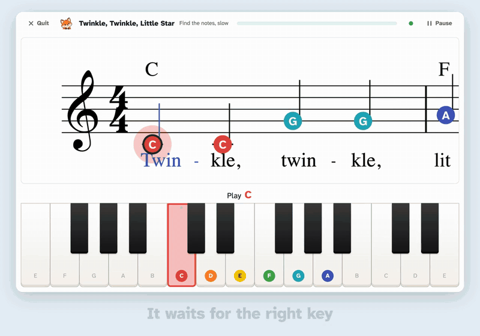
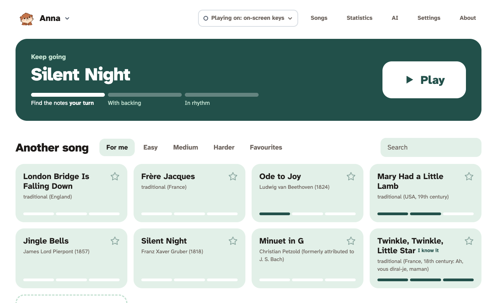
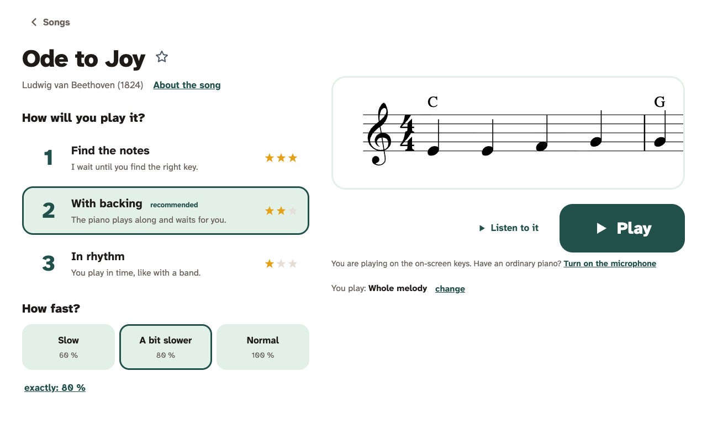
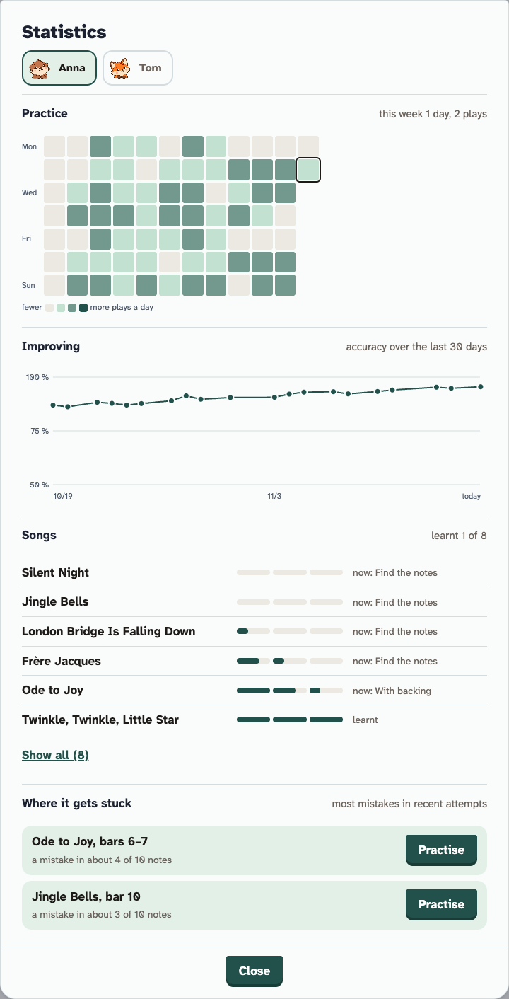

# Rusalka

Česky: [README.cs.md](README.cs.md)

Rusalka is a free, open-source piano app for children and beginners. Pick a song, play it on a piano connected over
MIDI, on an ordinary piano with the microphone, or on the keys on the screen, and learn it in three steps. It runs in
the browser, with no accounts; songs, players and results stay on your device.

**[Open Rusalka](https://rusalkapiano.com/)** (Chrome or Edge for a MIDI piano)



## Why Rusalka exists
Rusalka was made by a dad of two wonderful children who wanted to play their favourite songs on the piano. We found
plenty of sheet music for them at home and online, but the children can't read it reliably yet. So Rusalka is the
result of our joint effort (nobody is a better or more honest QA tester than a small child) to find a fun way for
children and beginners to play the songs they choose and learn them.

The timing worked out nicely with how good today's AI language models have become. They can turn a PDF or an
ordinary photo of sheet music into a format Rusalka understands. That's why Rusalka comes with add-ons for AI tools:
they convert sheet music, make an easier version of a song, or tell parents how the children got on with their music
over the past week. An ordinary AI chat is all you need; Rusalka itself doesn't send your data anywhere.

No AI? No problem. Rusalka has songs ready to play, from children's and folk songs to Christmas carols and classical
pieces.

## What it does
- Each song is learnt in three steps. *Find the notes* waits for the right key, *With backing* plays along and waits
  for you, and *In rhythm* keeps the tempo and scores your timing. *Listen* plays the whole song with both hands at
  its normal speed. The practice speed goes from slow to normal as the player gets better.
- The notes are made for children who can't read music yet: note names inside the note heads, notes coloured like the
  keys, lyrics under the notes, and the next key lit up on the on-screen keyboard.
- You can play a piano over MIDI (USB or Bluetooth), an ordinary piano through the microphone, or the keys on the
  screen. The choice is made once per device, with the button at the top of Home.
- Your own songs go in as MusicXML directly; MIDI is converted by the app, and PDFs and photos through an AI chat
  (below). The app also links to free sheet music.
- The accompaniment is the left hand from the score, or Rusalka plays along from the chord symbols. The sound is a
  recording of a Yamaha C5 grand piano.
- Statistics show parents how regularly each child practises, whether they are getting more accurate, how far they
  are with each song, and where they get stuck, with a button that practises exactly that spot.
- Advanced players can choose "All the notes", which plays the score as written (every voice in both hands,
  dynamics, pedal, key and time changes), switch to a full-page view, and with a MIDI piano get feedback on their
  dynamics.
- The app speaks 16 languages and starts in your browser's; change it on the first screen or in Settings. Note names
  follow the language (C D E F G A B, C D E F G A H or Do Re Mi).

| Choosing a song | Before playing |
|---|---|
|  |  |



## Getting started
1. Open [Rusalka](https://rusalkapiano.com/). It works best on a computer (Mac or PC) in **Chrome or Edge**: only
   there do a MIDI piano and saving to a folder work. In Safari you play on the on-screen keys or with the microphone.
   On an iPad or iPhone you can try a MIDI piano in the [Web MIDI Browser](https://apps.apple.com/app/web-midi-browser/id953846217)
   app (App Store), but Rusalka hasn't been tested in it. You can also install it as an app (**Install** in Chrome's address bar, **Apps →
   Install this site as an app** in Edge). After the first visit it works offline too: it keeps itself in the browser
   and updates itself when the internet is back.
2. Connect the piano with a USB cable or over Bluetooth (on a Mac: Audio MIDI Setup → Window → Show MIDI Studio →
   Bluetooth icon → **Connect**) and allow MIDI when the browser asks. Without a digital piano, choose **Microphone**
   or **On-screen keys** with the button at the top of Home.
3. Pick a song and play. You can create a profile under **Guest → + New player** on Home. The data stay in the browser; **Settings → Data and backups** downloads a backup or
   restores one, and in Chrome and Edge on a computer it can keep everything in a folder instead (**Save to a
   folder…**).

## AI tools: any AI chat
Rusalka itself does not use AI and sends none of your data anywhere. An AI chat you already use (Claude, ChatGPT or
another) does the work; you copy and paste. Everything is under **AI** at the top:

- **Sheet music from a photo or PDF:** *Copy instructions*, paste them into the chat with the photo or PDF, then
  paste the answer back with *Paste notes from the AI chat*. Rusalka checks the bar lengths, renders the notes to
  compare with the original and adds the song.

  

  The song in the demo is *Twinkle, Twinkle, Little Star* (traditional tune, words by Jane Taylor, 1806), engraved for the demo.
- **A summary of the week:** *Copy results* (the text contains the players' names and results) and paste it into the
  chat.
- **An easier version of a song** (melody within five fingers, right hand only…): *Choose a song*, then *Easier
  version*, and paste the answer back as above.

Optional: the skills `rusalka-sheet-music` and `rusalka-progress` (zips linked under AI and attached to
[Releases](../../releases)) for Claude (Settings → Skills → Upload) or ChatGPT (Skills → Create → Upload from your
computer). Then "add this to Rusalka" is enough, and where the chat can run code it checks the bar lengths and
compares a rendered picture with your original. The same skills work in Claude Code and Codex
([INSTALL-AGENT.md](INSTALL-AGENT.md)).

## Privacy
Rusalka sends none of your data to the internet. Songs, player profiles and results stay in the browser or in the
folder you choose. The published website counts visits anonymously with GoatCounter (no cookies, no personal data);
a local copy counts nothing. The only outside links are the ones in the "Where to get sheet
music" window.

## Songs and copyright
The built-in samples in `songs/` are public-domain songs. The [library](library/README.md) also lists individual permissions.
Sheet music you add stays with you; please don't publish copyrighted songs without the authors' permission.

## Development
```
npm install && npm run vendor
npm test                       # tests (static/lib, storage, MIDI output, skills)
./run_dev.sh                   # dev server on a free port from 8766, opens Chrome (Web MIDI and the folder work on localhost)
npm run dev                    # the same server on http://localhost:8765, nothing else
npm run web                    # static website into web/ (deployed by .github/workflows/pages.yml on every push to main)
npm run library                # song library library/ → build/library/ (checks; review page /library/review.html)
npm run skill                  # after changing song.js / notation.js / format.md: the skill's copies (a test checks this)
npm run skills                 # skill zips into build/; release: tag v* → release.yml
```
UI checks and the README pictures need Chrome and playwright-core: `PLAYWRIGHT_CORE=… node tools/check-ui.mjs`,
`PLAYWRIGHT_CORE=… node tools/check-offline.mjs` (the built web/ without the internet and its update),
`PLAYWRIGHT_CORE=… node tools/readme-images.mjs` (made-up players and practice, free sample songs). User guide and
architecture: [GUIDE.md](GUIDE.md).

## Licence
MIT, © 2026 Jiří Nečas, see [LICENSE](LICENSE). The library transcriptions of public-domain or CC0 sources and the
library index are [CC0](LICENSES/CC0-1.0.txt). The original composition *Filípkova písnička* is included by permission.
See [the library licence](library/README.md) and [third-party notices](THIRD_PARTY_NOTICES.md).
